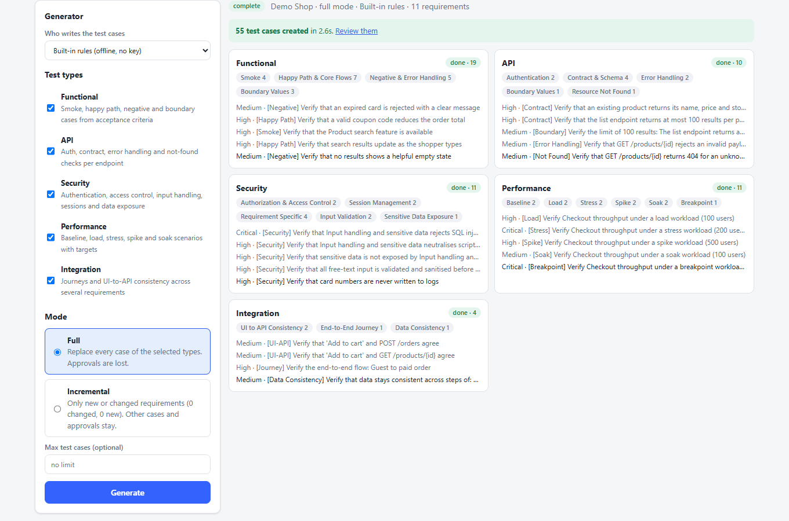
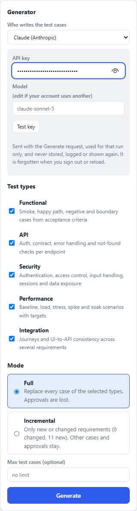
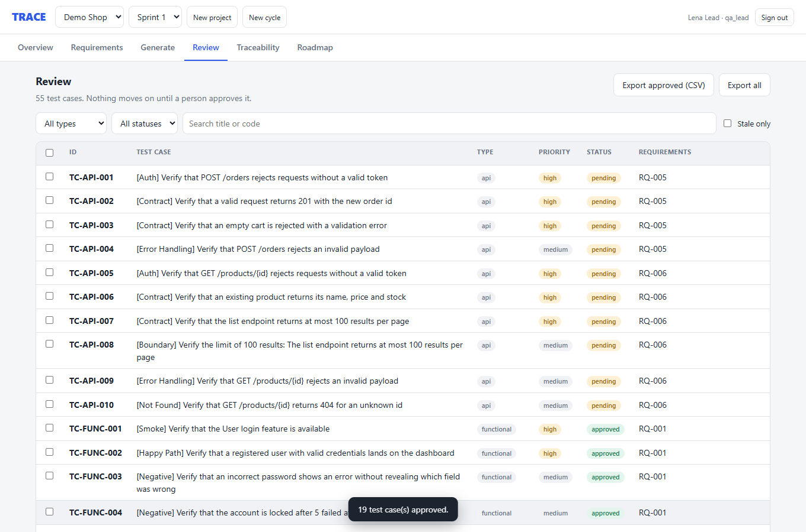
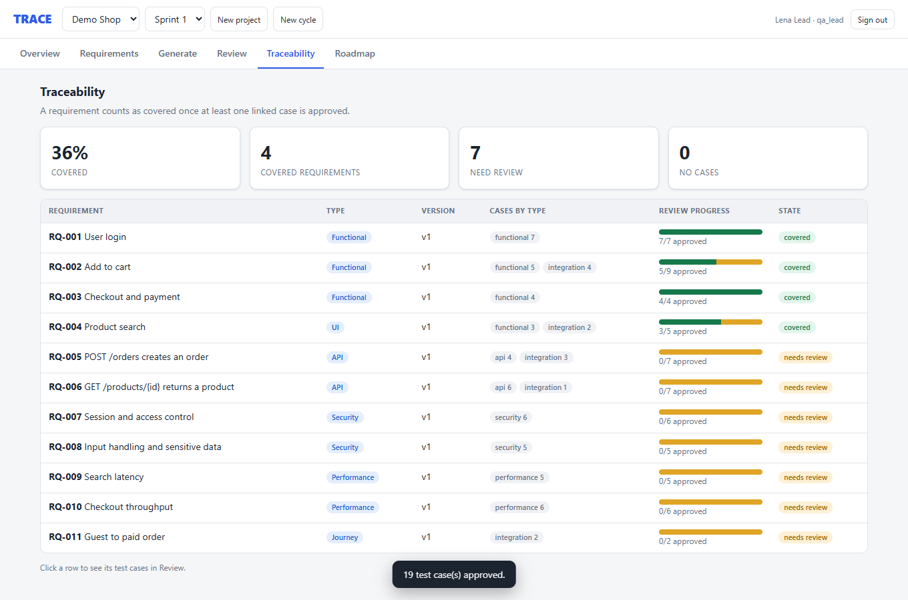

# TRACE

**T**raceable **R**equirements **A**nd **C**ases **E**ngine

**Turn requirements into reviewed, traceable test cases, and keep them current as the requirements change.**
A small local web app that shows how an AI-assisted test design workflow can be trustworthy: specialised
generators write the cases, a person approves them, every case is linked back to the requirement it covers,
and changing a requirement rebuilds only what it affects.



## Why this exists

Writing test cases by hand is slow, and it is usually the bottleneck of a release. Asking a chat model to
"write some tests" is fast, but the result is hard to trust and hard to maintain:

| The problem | What TRACE does about it |
|---|---|
| Output is a wall of text with no structure | Every case has a title, priority, preconditions, numbered steps with expected results, and test data |
| One big prompt gives patchy coverage | Five specialised agents (functional, API, security, performance, integration) each work on the requirements they understand |
| Nobody knows which requirement a test covers | Every case is linked to a requirement, and a matrix shows what is covered, awaiting review, or has no tests |
| AI output goes straight into use unchecked | A human review gate: nothing counts as covered until a person approves it, and the API enforces who is allowed to |
| Specs change and the tests rot | Each link remembers the requirement version it was written against. Edit a requirement and the affected cases are flagged **stale** |
| Regenerating everything throws away reviewed work | **Incremental** mode rebuilds only the changed parts and leaves every other approval alone |
| You cannot try an AI idea without keys and setup | It runs offline by default. Optionally paste your own Claude or ChatGPT key to compare a real model |

It is deliberately small. It is a working reference for the workflow and the design decisions behind it, and
a base you can extend (see the [Roadmap](ROADMAP.md), also a tab in the app).

## Quick start

Needs Python 3.10 or newer (developed and tested on 3.14). No database server, no cloud account, no API key.

```bash
git clone <this repo> trace
cd trace
python -m venv .venv

# macOS / Linux
source .venv/bin/activate
# Windows PowerShell
# .venv\Scripts\Activate.ps1

pip install -r requirements.txt
python run.py --open
```

The first start creates a local SQLite file and seeds a sample project ("Demo Shop") with 11 requirements.
Open http://127.0.0.1:8000 and pick one of the one-click demo accounts on the sign-in page.

| Account | Role | Can do |
|---|---|---|
| `viewer@demo.local` | viewer | read everything |
| `tester@demo.local` | tester | also approve and reject test cases |
| `lead@demo.local` | qa_lead | also edit requirements, generate, export |
| `admin@demo.local` | admin | everything |

Password for all of them is `demo123`. Reset to a clean slate with `python -m app.seed --reset`.
Run the tests with `pytest`.

## Try it with Claude or ChatGPT

By default a built-in rule engine writes the cases. It is deterministic, instant and works offline, so the demo
and the tests need nothing. To see what a real model does with the same requirements:

1. Sign in as `lead@demo.local` (or an admin) and open the **Generate** tab.
2. Under **Generator**, choose **Claude (Anthropic)** or **ChatGPT (OpenAI)**.
3. Paste your own API key, optionally change the model name, and press **Test key** to check it works.
4. Press **Generate**. The agent cards show "Written by Claude" or "Written by ChatGPT" when each one finishes.



What you should know before using a key:

- **Your key is never stored.** It travels with the Generate request over your own connection, is held in memory
  for that one run, and is not written to the database, the event stream, the audit log or any log. Provider error
  messages are scrubbed of it before they are shown. It is forgotten when you sign out or reload the page.
  Tests check that the key appears nowhere the app exposes.
- **It calls the provider from the server on your machine**, so your key does not pass through anyone else's service.
- **Requirement text is sent to the provider** (titles, descriptions, acceptance criteria). Use the demo data or
  non-sensitive requirements. Usage is billed to your own provider account.
- **Model output is checked before it is saved.** Cases that reference unknown requirement codes, have no steps, or
  have no title are dropped, and unknown priorities become "medium".
- **If a call fails** (bad key, quota, timeout), that agent falls back to the built-in rules, says so in the live view
  ("Written by rules (fallback)"), and the run still finishes.
- Model names are editable because accounts differ. Defaults are `claude-sonnet-5` and `gpt-4o`.
- Prefer a server-wide setting? Set `LLM_PROVIDER` (`anthropic` or `openai`), `LLM_API_KEY` and optionally
  `LLM_MODEL` in `.env`. The UI then needs no key.

## How it works

### The workflow

```
 Requirements ──► Generate ──► Review ──► Traceability ──► Export
      ▲               │            │            │
      │               │            │            └─ which requirements are covered by approved cases?
      │               │            └─ a person approves or rejects (roles enforced by the API)
      │               └─ five agents run in parallel and stream each case live
      └─ edit a requirement: it becomes v2 and its cases show as stale
                         └─► Generate (incremental): rebuild only what changed
```

### The pieces

- **Project, cycle, requirement.** A project holds cycles (a sprint or release). A cycle holds requirements, each with
  a type (Functional, UI, API, Security, Performance, Journey), a description, and acceptance criteria. Requirements are versioned.
- **Agents.** Each agent reads only the requirement types it understands and writes structured cases:

  | Agent | Reads | Writes |
  |---|---|---|
  | Functional | Functional, UI | smoke, happy path per criterion, negative cases, boundary values (finds limits like "at least 8 characters") |
  | API | API | auth, contract per criterion, error handling, not-found, boundaries, using the endpoint named in the requirement |
  | Security | Security | authentication, access control, injection and script payloads, sessions, sensitive data |
  | Performance | Performance | baseline, load, stress, spike, soak (and breakpoint), reading user counts and latency targets from the text |
  | Integration | Functional, API, Journey | end-to-end journeys and UI-to-API consistency, linking several requirements together |

- **Generation run.** `POST /generate` returns immediately and the work continues in the background. The agents run
  in parallel and each case is streamed to the browser as it is written. Everything is then saved in one transaction,
  and coverage gaps are computed (requirements that ended up with no cases, and why).
- **Review.** Approve, reject or reset one case or many. Approving marks a case ready for automation.
  Testers and above can review; the check is on the server, not just in the UI.
- **Traceability.** A requirement is "covered" once at least one linked case is approved. Each link also records which
  requirement version the case was written against.
- **Stale detection and incremental regeneration.** Every case has one *owner* requirement and may also cover others
  (a journey case covers several). When a requirement changes:
  1. its own cases, and cases that merely also cover it, are marked stale;
  2. an **incremental** run rebuilds the cases its owner requirements produce, and nothing else;
  3. every other case, with its approval, is left untouched;
  4. the run reports how many already-approved cases were replaced so reviewers know to look again.

  **Full** mode instead replaces every case of the selected test types. The mode defaults to incremental when it would help.
- **Live streaming that survives a refresh.** Events go to every open tab. The server keeps each run's history for 15
  minutes, so reloading the page mid-run rebuilds the progress view instead of losing it.
- **Safety rails.** One run per cycle (a second request gets HTTP 409). Requirements are locked while a run is active.
  Every consequential action is written to an audit log.

### Architecture

```
 browser (plain HTML, CSS, JS, no build step)
   |  REST + Server-Sent Events
   v
 FastAPI ── sign-in + roles (signed tokens, hashed passwords)
   |
   |  POST /generate -> returns at once, work continues in a background task
   v
 orchestrator ─ load context ─ run agents in parallel ─ save in one transaction ─ coverage gaps
                                |   rule engine, or Claude / ChatGPT over HTTPS (validated)
                                v
                         event bus (per cycle, replayable) -> SSE to any number of tabs
   |
   v
 SQLite via SQLAlchemy: projects, cycles, requirements (versioned), test cases, steps, test data,
                         traceability links, generation runs, audit log
```

## Five minute tour

1. **Overview**: "Demo Shop" has 11 requirements and no test cases yet.
2. **Generate**: leave all five types ticked and press Generate. Each agent card fills in live.
3. **Review**: filter to Functional, select all, approve. Open a case to see steps, expected results and test data.
4. **Traceability**: requirements covered by an approved case turn green.
5. **Requirements**: edit *User login* and add an acceptance criterion. It becomes v2 and its approved cases show as **stale**.
6. **Generate** again. It defaults to **Incremental**: only the changed requirement is rebuilt, and the run tells you how many approved cases were replaced.
7. **Roadmap**: what is built and what is planned next.





## API at a glance

Interactive docs at http://127.0.0.1:8000/docs.

| Method and path | Purpose | Role |
|---|---|---|
| `POST /api/auth/login` | get a bearer token | public |
| `GET/POST /api/projects` | list, create (also creates a first cycle) | read, qa_lead |
| `GET /api/cycles/{id}` | counts, coverage, stale totals, last run | read |
| `GET/POST/PATCH/DELETE /api/cycles/{id}/requirements` | manage requirements (edits bump the version) | read, qa_lead |
| `POST /api/cycles/{id}/generate` | start a run: `selected_test_types`, `mode` (`full`/`incremental`), `max_tcs`, and optionally `provider` (`rules`/`anthropic`/`openai`), `api_key`, `model` | qa_lead |
| `GET /api/cycles/{id}/generate/stream` | live events (SSE) | read |
| `GET /api/cycles/{id}/generate/status` | snapshot used to rebuild the view after a refresh | read |
| `GET /api/llm/providers` | generators offered by the picker (never returns a key) | read |
| `POST /api/llm/check` | one tiny request to confirm a key works | qa_lead |
| `GET /api/cycles/{id}/test-cases` | list, filter by `test_type`, `status`, `q` | read |
| `PATCH /api/cycles/{id}/test-cases[/{tc}]` | approve, reject, reset (single or bulk) | tester |
| `GET /api/cycles/{id}/traceability` | requirement coverage matrix | read |
| `GET /api/cycles/{id}/export/csv` | CSV with one row per case and per step | qa_lead |
| `GET /api/roadmap` | what is built and what is next | public |

Stream events: `pipeline_start`, `agent_start`, `tc_created`, `agent_warning`, `agent_complete`, `generation_complete`, `generation_error`.

## Configuration

Everything is optional. Copy `.env.example` to `.env` to change a default.

| Variable | Default | Meaning |
|---|---|---|
| `DATABASE_URL` | local SQLite file in `data/` | any SQLAlchemy URL |
| `SECRET_KEY` | a development value | signs login tokens; change it for anything shared |
| `SEED_DEMO` | `1` | create demo accounts and the sample project on first start |
| `GENERATION_DELAY_MS` | `120` | pause between streamed cases so the live view is visible |
| `LLM_PROVIDER` / `LLM_API_KEY` / `LLM_MODEL` | `rules` / empty / empty | optional server-wide generator defaults |

## Project layout

```
app/
  main.py              app wiring, startup, static files
  config.py            settings from environment / .env
  db.py  models.py     database setup and tables
  security.py          tokens, password hashing, role checks
  events.py            in-process event bus with replay
  routers/             auth, projects, requirements, generate, testcases, llm
  services/
    agents.py          the five rule-based agents
    llm.py             Claude and ChatGPT generators, key handling, validation
    generation.py      orchestrator: parallel run, persistence, gaps
    reporting.py       serialisation, traceability matrix, CSV export
  seed.py              demo users and sample project
  roadmap.json         single source for the Roadmap tab and ROADMAP.md
  static/              the web UI
tests/                 pytest: agents, API, roles, streaming, regeneration, providers
scripts/build_roadmap_md.py
```

## Known limits

- One server process: the event bus is in memory. Running several workers needs Redis pub/sub (on the roadmap).
- SQLite with `create_all` and no migrations. After pulling a schema change run `python -m app.seed --reset`.
- The sign-in page lists the demo accounts. For anything shared, remove `GET /api/auth/demo-users` and set a real `SECRET_KEY`.
- The rule engine writes sensible, structured cases from acceptance criteria. A model can reason about your domain
  in ways rules cannot, but it can also be wrong, which is exactly why the review gate exists.
- The Claude and ChatGPT calls are covered by tests against a mocked HTTP layer. I have not run them against live accounts.
