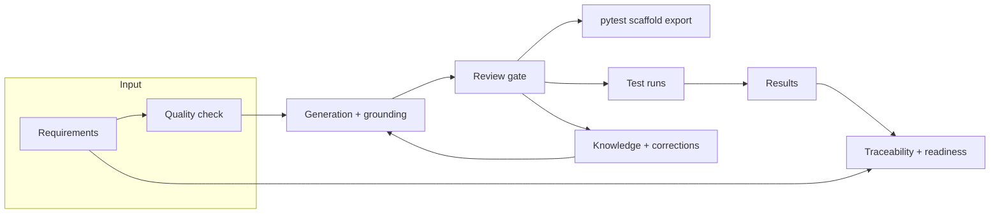

# TRACE 0.3 design: closing the loop

Version 0.2 takes a requirement to a reviewed, traceable test case. It stops there. Nobody can say whether the
requirement was written well enough to test, and nothing records whether a test was ever run or what happened.
This document picks the next slice of work, designs it, and says what is deliberately left for later.

## 1. What could be added

Each candidate is scored on value to a QA team, fit with what exists, and size.

| Candidate | Value | Fit | Size | Decision |
| --- | --- | --- | --- | --- |
| Requirement quality check before generation | High: bad input is the biggest cause of bad cases | Pure function, no new infrastructure | S | Build now |
| Test execution tracking (runs, results, pass rate) | High: turns a case list into a test cycle | Cycles and approved cases already exist | M | Build now |
| Automation scaffold export (pytest for API cases) | Medium: saves the dull part of automation | Cases already hold method, path and steps | S | Build now |
| Coverage by result (requirement to last result) | High, and almost free once results exist | Extends the traceability matrix | S | Build now |
| Import requirements from a document (txt, md, docx) | Medium | Needs extraction and review UI | M | Later |
| Case history and diff across edits | Medium | Needs a revisions table | M | Later |
| Comments and assignment on cases | Medium | Needs notifications to be useful | M | Later |
| Push to Jira or a test management tool | High for adoption | Needs per-user credentials and mapping | L | Later |
| Architecture and design half (components, flows, risks per requirement) | High, but a different product surface | New pipeline, new review model | L | Separate design |
| Browser execution with a locator-verified script generator | High | Needs a sandbox and Playwright | XL | Already on the roadmap |

The first four share one idea: **the requirement is checked on the way in, the case is reviewed in the middle, and
the result is recorded on the way out**, all attached to the same requirement codes. That is the 0.3 theme.

## 2. Scope of 0.3

1. **Requirement quality check.** A deterministic linter that scores each requirement and says what to fix.
2. **Test runs.** Create a run from the approved cases of a cycle, record a result per case, close the run,
   and read a report.
3. **Result-aware traceability.** Each requirement shows its latest result, and the cycle shows a release-readiness
   view: covered and passing, covered and failing, covered and not run, uncovered.
4. **pytest scaffold export.** Approved API cases become a runnable skeleton with one test per case.

Out of scope: running tests for the user, bug tracker sync, any change to how cases are generated.

## 3. Where it fits



New code, by layer:

```
app/models.py                 TestRun, TestResult
app/services/quality.py       lint rules, scoring, similarity between requirements
app/services/execution.py     create run, record result, run report, readiness
app/services/scaffold.py      approved API cases -> pytest source
app/routers/quality.py        GET quality for a cycle or one requirement
app/routers/runs.py           runs and results, report, scaffold download
app/static/app.js, index.html  Quality badges, Execution tab, readiness panel
tests/test_quality_check.py, test_runs.py, test_scaffold.py
```

Nothing in the generation path changes. The quality check is advisory: it never blocks generation, because a team
may knowingly generate from a rough requirement and fix it from review.

## 4. Requirement quality check

Pure functions over `(title, description, req_type, acceptance_criteria)`. No model call, so it is instant, free and
the same every time.

Each finding has `code`, `severity` (`error`, `warning`, `info`), `field` (`title`, `description`, or
`acceptance_criteria[n]`), a `message` and a `suggestion`.

| Code | Severity | Fires when |
| --- | --- | --- |
| `NO_CRITERIA` | error | no acceptance criteria |
| `PLACEHOLDER` | error | TBD, TBC, TODO, "to be decided" or `???` anywhere |
| `VAGUE_TERM` | warning | words such as fast, easy, user-friendly, robust, seamless, appropriate, "as needed", "etc." |
| `UNMEASURED_PERFORMANCE` | warning | type is Performance and no number appears in the description or criteria |
| `API_NO_ENDPOINT` | warning | type is API and no `METHOD /path` appears |
| `SHORT_CRITERION` | warning | a criterion has fewer than 4 words |
| `COMPOUND_CRITERION` | info | a criterion joins several checks with "and" or "or" more than once |
| `FEW_CRITERIA` | info | one criterion on a Functional or UI requirement |
| `THIN_DESCRIPTION` | info | description shorter than 20 characters |
| `NEAR_DUPLICATE` | info | token overlap with another requirement in the cycle is at least 0.8 |

Score is `100 - 25*errors - 10*warnings - 3*info`, floored at 0. Grade: A from 85, B from 70, C from 50, D below.
The weights are a judgment, and they are constants at the top of the module so a team can change them.

Cycle result: the list of requirements with score and findings, plus a summary (average score, count per grade,
requirements with errors).

## 5. Test runs

### Data model

```
TestRun     id, cycle_id, name, status (open|closed), created_by, created_at, closed_at
TestResult  id, run_id, tc_id, status, notes, defect_ref, executed_by, executed_at
            unique (run_id, tc_id)
```

`status` for a result is one of `not_run`, `passed`, `failed`, `blocked`, `skipped`.

A run contains a **snapshot of the approved cases at creation time**: one `TestResult` row per case, status
`not_run`. Cases approved later do not join an existing run, so a run stays a fixed question that gets answered.
A `defect_ref` is free text (an issue key or a URL). TRACE does not call out to any tracker.

New tables are created by `create_all`, so no column migration is needed.

### Rules

- Creating a run needs role `qa_lead` and at least one approved case. Recording results needs `tester`. Reading
  needs any role.
- Results can be changed while the run is open. A closed run is read-only, which is what makes it a record.
- A `failed` result must carry notes. `blocked` should, but is not forced.
- Deleting a case removes its results (foreign key cascade). Re-approving or editing a case does not touch results.
- A case whose requirement changed after the run started is reported as **stale in run**, because the result may no
  longer mean what it did.
- Every create, record and close writes an `AuditLog` row.

### Run report

```
counts          per status, and `executed` = everything except not_run
pass_rate       passed / (passed + failed + blocked), skipped left out, null when none of those exist
progress        executed / total
by_type         counts per test type
by_priority     counts per priority, failed critical and high listed first
failures        failed and blocked cases with notes and defect_ref
```

### Readiness (cycle level)

For each requirement, take the result of its linked approved cases from the **latest run that contains them**:

| State | Meaning |
| --- | --- |
| `passing` | every linked executed case passed and none failed |
| `failing` | at least one linked case failed |
| `blocked` | none failed, at least one blocked |
| `not_run` | approved cases exist but none executed |
| `no_approved_cases` | nothing approved yet |

Cycle summary: counts per state and `ready_pct`, the share of requirements that are `passing`. The existing
traceability matrix gains a `result` field per row, so the Traceability tab and the readiness panel use one source.

## 6. pytest scaffold export

`GET /api/cycles/{id}/export/pytest` returns a single `.py` file for the approved **API** cases.

- One function per case, named from the case code, for example `test_tc_api_001`.
- `@pytest.mark.requirement("RQ-005")` from the traceability links, so a run can be filtered by requirement.
- The method and path come from the case's `endpoint` and `method` test data. A case without them is listed in a
  comment as skipped, not guessed.
- Each step becomes a comment with its action and expected result, followed by `# TODO` and a `requests` call
  skeleton for the first step that names a method. Assertions are left for a person.
- A header says the file is a scaffold: base URL from `TRACE_TARGET_URL`, no assertions are generated.

This is honest about what it is. It saves the typing and keeps the case-to-code link, and it does not claim the tests
pass. Locator-verified UI scripts stay on the roadmap because they need a live browser.

## 7. Security and operations

- All new endpoints sit behind the same bearer token and role checks as the rest.
- The scaffold writer escapes case text into comments and string literals. Test data values are never evaluated.
- Runs and results are small rows. Report queries are one pass over a run's results, bounded by the case count.
- No new settings and no new dependency.

## 8. Tests

- Quality: each rule fires on a crafted requirement and stays quiet on a good one, score and grade boundaries,
  near-duplicate detection, the cycle endpoint.
- Runs: create requires approved cases, role enforcement, record and change results, failed needs notes, close makes
  it read-only, report maths with zero executed, readiness states across two runs.
- Scaffold: output compiles with `ast.parse`, skips cases without an endpoint, escapes awkward characters, requires
  `qa_lead`.
- Existing suites must stay green.

## 9. Rollout

Build in three steps that each stand alone: quality check, runs and readiness, scaffold export. The roadmap page
and README are updated at the end.

## 10. Deferred, with the shape of the answer

**Architecture and design half.** A second pipeline that takes the same requirements and drafts components, data
flows and risks, each item citing the requirement that drove it, with its own review gate. It reuses grounding
(every design element must cite a requirement) and Knowledge (constraints, standards). It needs its own data model,
so it gets its own document.

**Jira and test-tool sync.** A connector interface (`push_cases`, `pull_requirements`, `push_defect`) with
per-user credentials stored encrypted, plus a mapping table between TRACE codes and external keys.

**Document import.** Extract candidate requirements from a text or Word file, show them in a staging list with the
quality check already applied, and let a person accept them into a cycle.

**Case history.** A `TestCaseRevision` table written on edit, with a diff view in the drawer.
