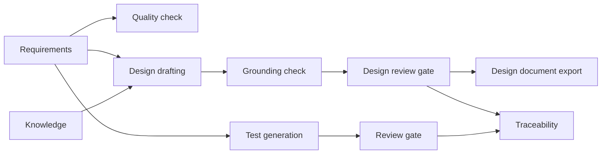

# TRACE 0.4 design: the design pipeline

TRACE turns requirements into reviewed test cases. The same requirements also drive planning: what has to be built,
how the parts talk to each other, and what could go wrong. 0.4 adds a second pipeline that drafts that, with the same
rules that keep the test pipeline honest: every item cites a requirement, a person reviews it, and nothing reaches
the output until it is approved.

## 1. What it produces

Three kinds of design element, all tied to requirement codes:

| Kind | Code | What it says | Detail fields |
| --- | --- | --- | --- |
| Component | `CMP-001` | A part of the system that has to exist | responsibility, interfaces, depends on |
| Data flow | `FLW-001` | Data moving between two components, or to an outside system | from, to, data, trigger |
| Risk | `RSK-001` | Something that could stop a requirement being met | likelihood, impact, mitigation |

Out of scope: diagrams drawn in the browser, code generation, cost or schedule estimates, and anything that is not
traceable to a requirement.

## 2. Where it fits



The two pipelines share requirements, project knowledge and the review model. They do not share tables or code
paths, so a problem in one cannot corrupt the other.

## 3. Data model

```
DesignElement  id, cycle_id, kind, code, title, summary, detail (JSON), evidence,
               status (pending|approved|rejected), review_notes, reviewed_by, reviewed_at,
               edited, source, warnings (JSON), created_at
DesignLink     id, cycle_id, element_id, requirement_id, req_version
```

`DesignLink` mirrors `Traceability`: it records the requirement version the element was written against, so a
requirement that changes afterwards marks the element **stale**. New tables come from `create_all`, so there is no
migration.

Detail by kind, stored as JSON so one table serves all three:

```
component  {responsibility, interfaces: [..], depends_on: [component code, ..]}
flow       {from_code, to_code, from_name, to_name, data, trigger}     (an outside system has no code)
risk       {likelihood, impact, mitigation, severity}                  severity is computed, see below
```

## 4. Drafting

Two generators behind one contract, the same split the test pipeline uses.

**Built-in rules** (no key, instant, repeatable). They read requirement text and produce:

- Components from a table of common areas (sign-in and sessions, cart, payment, search, orders, catalogue,
  notifications, reporting, profile). Areas that match nothing get one component named after a Functional requirement.
  Structural components are added when the requirements need them: a web UI for UI requirements, an API layer for API
  requirements, a data store when requirements talk about saving or history.
- Flows from endpoints (`POST /orders` becomes client to API layer) and from outside systems named in the text
  (payment provider, email, SMS, single sign-on).
- Risks from performance targets, security wording, outside dependencies, and from the requirement quality check:
  a requirement with no criteria or a leftover TBD is itself a design risk.

Every rule quotes the sentence it came from as `evidence`.

**Claude or ChatGPT.** One call per cycle, forced through a `submit_design` tool so the answer is structured. The
prompt carries the requirements, project knowledge, and what reviewers approved and rejected before, as for test
cases. The call is synchronous: the request returns when the draft is saved, and the page shows a working state. One
model call is short enough that streaming progress would add machinery without adding information.

**Grounding check** (applies to both). An element is dropped when:

- it cites no known requirement code,
- its `evidence` is missing or does not appear in the cited requirements or project knowledge,
- a flow names a component that is not in the draft or already approved,
- it duplicates another element of the same kind (title similarity of at least 0.9).

Dropped items are counted and reported, never silently lost. A model may also return `clarifications`, questions it
needed answered instead of guessing; they are shown to the reviewer.

## 5. Severity

A risk's severity is not asked of the model. Likelihood and impact are each low, medium or high (1 to 3), and the
product decides:

| Product | Severity |
| --- | --- |
| 6 or 9 | high |
| 3 or 4 | medium |
| 1 or 2 | low |

The thresholds are constants at the top of the module.

## 6. Review and regeneration

- Roles match the test pipeline: a QA lead drafts, a tester reviews and edits, anyone can read.
- A reviewer approves, rejects (with a reason) or edits. An edit marks the element as human-corrected.
- Drafting again **keeps approved and human-edited elements** and replaces the rest. A new element that matches one
  of those is skipped, so approving or correcting something once is enough. Codes keep counting up and are never reused.
- Rejection reasons and approved elements feed the next draft's prompt.
- Every draft, review and edit writes an `AuditLog` row.

## 7. Coverage and traceability

- Each requirement shows how many design elements cite it. A requirement with none is a **design gap**, listed in
  the design summary.
- The traceability matrix gains a `design` list per requirement (codes of approved elements), so one screen shows
  requirement, design and tests together.

## 8. Export

`GET /api/cycles/{id}/design/export/md` returns a Markdown document of **approved** elements only: a component
table, a Mermaid diagram of components and flows, a risk register sorted by severity, and a requirement-to-design
table. Mermaid renders on GitHub and in most Markdown tools, so TRACE does not need a diagram library. It returns
409 when nothing is approved.

## 9. API

| Endpoint | Purpose | Role |
| --- | --- | --- |
| `GET /api/cycles/{id}/design` | elements, counts, coverage, gaps | read |
| `POST /api/cycles/{id}/design/generate` | draft, keeping approved elements | qa_lead |
| `PATCH /api/cycles/{id}/design/{eid}` | approve, reject or reset one | tester |
| `PATCH /api/cycles/{id}/design` | the same for several | tester |
| `PUT /api/cycles/{id}/design/{eid}` | correct title, summary or detail | tester |
| `GET /api/cycles/{id}/design/export/md` | approved design document | qa_lead |

## 10. Security and operations

- Same bearer token and role checks as the rest. API keys follow the rules of the test pipeline: kept in memory for
  the request, never stored, logged or echoed, scrubbed from provider errors.
- Model output is parsed into plain strings and bounded lists before storage, and escaped when written to Markdown.
- No new settings and no new dependency. The provider code is shared; the tool definition becomes a parameter.

## 11. Tests

- Rules: each kind is produced from a matching requirement, every element carries evidence that is really in the
  requirement, an empty cycle gives nothing, severity maths at the boundaries.
- Grounding: unknown codes, missing or invented evidence, unknown flow endpoints and duplicates are dropped.
- Providers: both Claude and ChatGPT shapes against a mocked HTTP layer, key never leaks, a bad answer falls back.
- API: role enforcement, regeneration keeps approved items, rejection needs a reason, stale after a requirement edit,
  coverage gaps, export needs approved items, traceability gains the design column.
- Existing suites stay green.

## 12. Limits, stated plainly

- The rules read keywords. They find the common parts of a typical business application and miss anything unusual,
  which is why they are a starting point for a reviewer and not an architecture.
- Drafting does not know your real system. A model may propose a component you already have, so approving, merging
  and rejecting is the point of the review gate.
- Diagrams are exported as text. A drawn view in the browser is later work.
